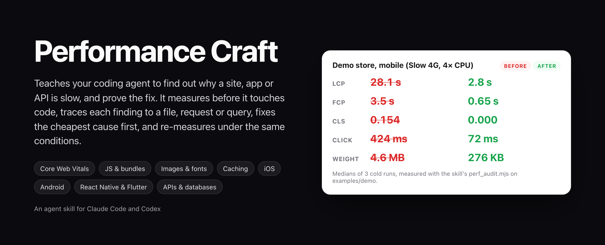
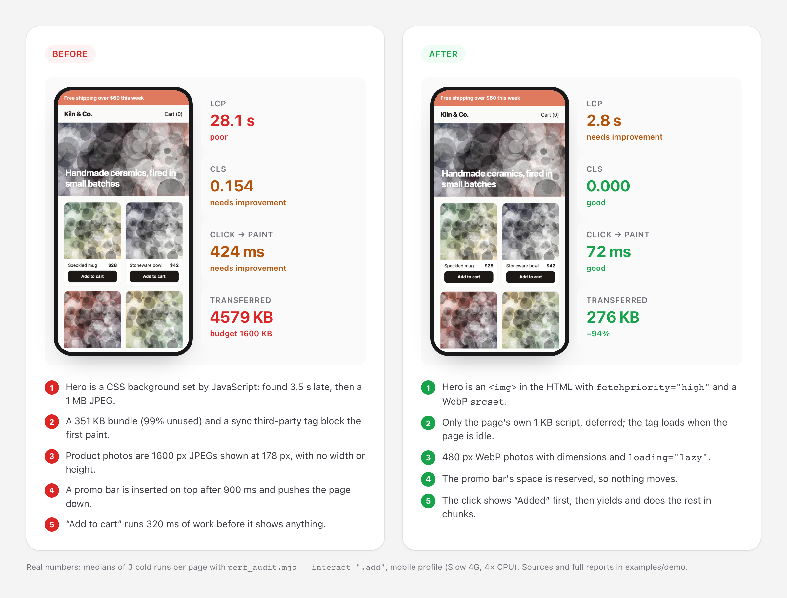
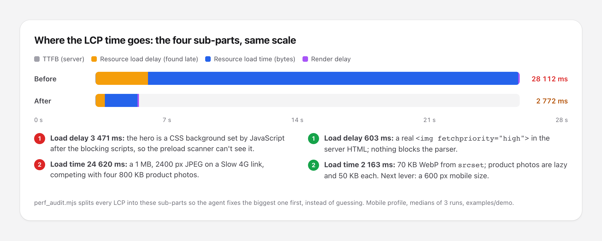
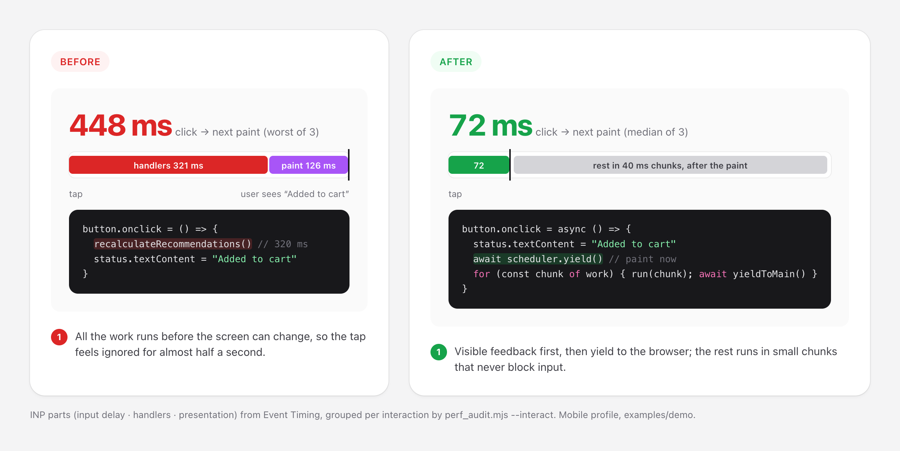
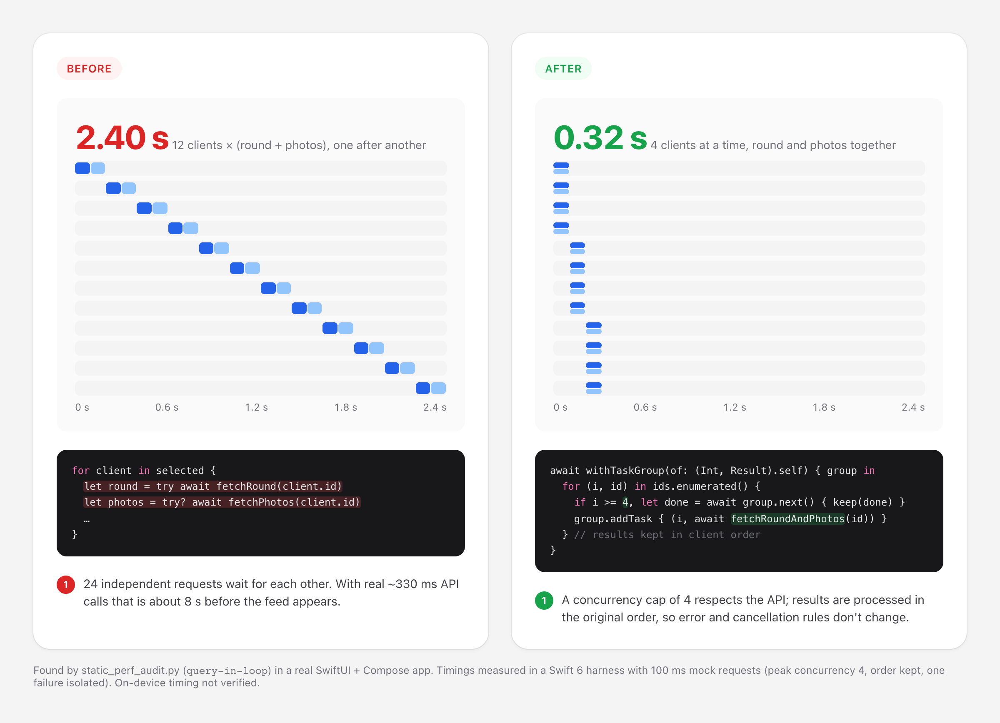
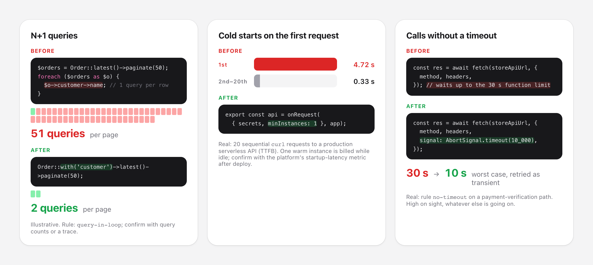
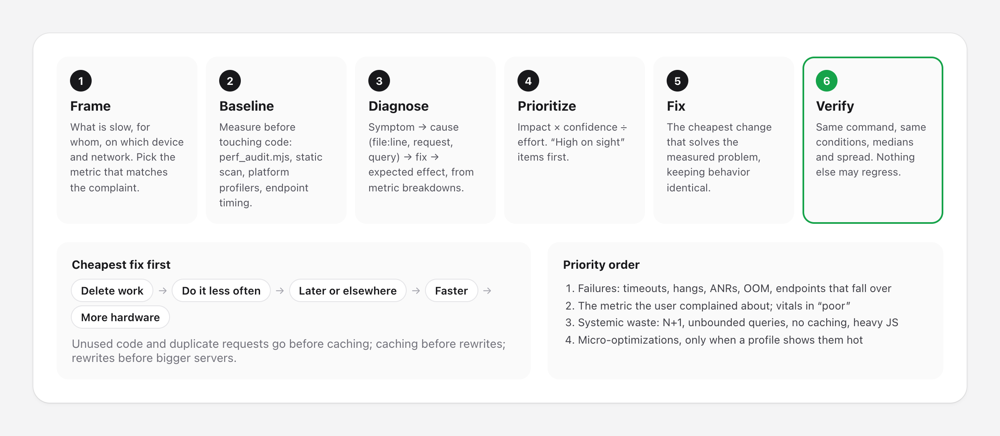
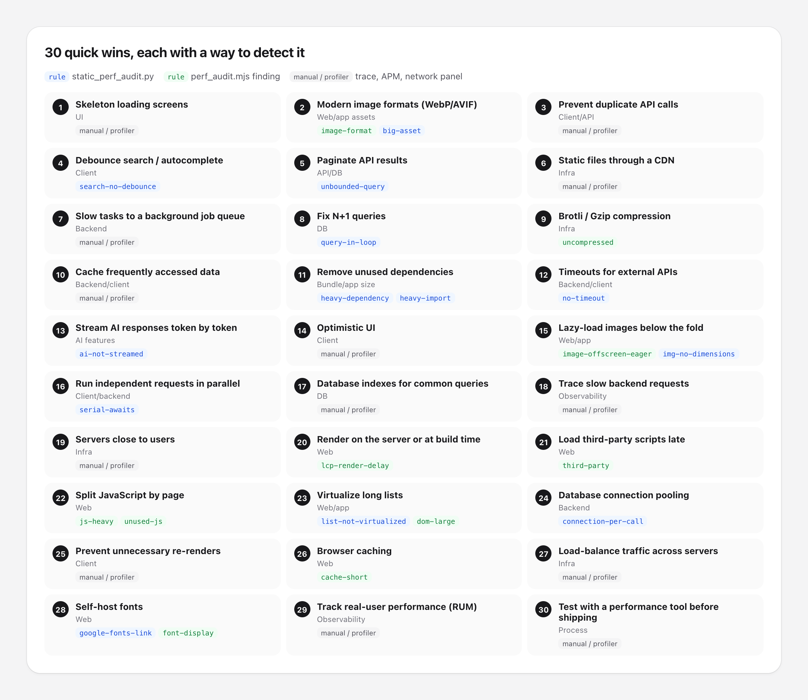

<p align="center">
  
</p>

<p align="center">
  <a href="LICENSE"></a>
  
  
  
</p>

**Performance Craft** is an [agent skill](https://docs.claude.com/en/docs/claude-code/skills) that turns your coding agent into a careful performance engineer. When you say *"the site is slow"*, *"the app takes forever to open"* or *"this API times out"*, it doesn't sprinkle `useMemo` and hope. It measures first, under realistic conditions, finds which part of the time is actually the problem, fixes the cheapest cause, and measures again with the same command. Every finding points to a number or a `file:line`. Anything it couldn't measure is marked *Not verified*.

It covers the whole path a user waits on:

- **Web loading and responsiveness**: Core Web Vitals (LCP, INP, CLS), TTFB, JavaScript cost, images, fonts, caching, third parties
- **Mobile apps**: launch time, hangs, scrolling jank, memory and battery in SwiftUI/UIKit, Jetpack Compose, React Native and Flutter
- **Backends**: N+1 queries, unbounded queries, missing indexes, timeouts, connection pooling, caching, queues, cold starts and AI streaming

It ships with three measuring tools: a **lab audit** that drives your installed Chrome under mobile throttling and compares before/after runs with a noise verdict, a **field data** reader for Core Web Vitals of real users (CrUX), and a **static scanner** that finds performance leads in code across nine stacks.

---

## Contents

- [Before and after](#before-and-after)
- [What the agent reports](#what-the-agent-reports)
- [How it works](#how-it-works)
- [30 quick wins](#30-quick-wins)
- [What it pays attention to](#what-it-pays-attention-to)
- [Foundations: what we follow](#foundations-what-we-follow)
- [What it will not do](#what-it-will-not-do)
- [Install](#install)
- [Usage](#usage)
- [Lab audit: perf_audit.mjs](#lab-audit-measure-what-the-browser-actually-did)
- [Static scan: static_perf_audit.py](#static-scan-performance-leads-in-code)
- [Try the demo](#try-the-demo)
- [Repository layout](#repository-layout)
- [Credits and license](#credits-and-license)

---

## Before and after

All numbers below come from real runs. The demo store sources and full reports are in [`examples/demo`](examples/demo), and every mockup's HTML is in [`examples/`](examples).

### 1. A typical "vibe-coded" storefront, measured and fixed



> **Why:** nothing on this page is exotic. A hero set by JavaScript, a big bundle in `<head>`, 1600 px photos in 178 px cards, a late promo bar and a heavy click handler are what generated code often looks like. On a fast laptop the page feels fine; on a mid-range phone on 4G the main image takes 28 seconds. The skill runs [`perf_audit.mjs`](#lab-audit-measure-what-the-browser-actually-did) on both profiles, gets 14 findings, fixes them in priority order and re-runs the same command.

### 2. LCP: fix the biggest sub-part, not the first idea



> **Why:** "LCP is slow" can mean a slow server, an image found late, an image that's too heavy, or rendering that's blocked, and each has a different fix. The audit breaks every LCP into TTFB, resource load delay, resource load time and render delay, so the agent attacks the largest part first. Here the hero was found late *and* was a 1 MB JPEG; an `` with a WebP `srcset` fixed both. The report also says what's left: a 600 px mobile size would be the next lever.

### 3. INP: show something first, then do the work



> **Why:** a tap that takes 450 ms to change the screen feels broken, even when the work is necessary. With `--interact` the audit clicks safe controls and splits each interaction into input delay, handler time and presentation delay, grouped per interaction from the Event Timing API. The fix keeps the work but changes its order: visible feedback, `scheduler.yield()`, then small chunks.

### 4. Independent requests that wait for each other



> **Why:** an `await` inside a loop is invisible in review and adds up fast. This one came from a real SwiftUI + Compose app: a feed screen made 24 requests one after another, about 8 seconds with real API latency. The scanner flags it (`query-in-loop`), and the fix uses a task group with a concurrency cap of 4, keeping results in their original order so error and cancellation behavior doesn't change. The timing here is from a Swift 6 harness with mock requests; on-device timing is marked *Not verified*.

### 5. Backends: N+1, cold starts and missing timeouts



> **Why:** most "the app is slow" reports end at an API. The skill times the endpoint (p50/p95 over 20+ requests, not one), reads traces and query plans, and treats some problems as **high on sight** whatever else is going on: a query per list row, outgoing calls without a timeout on a request path, a database connection per request. The cold-start and timeout cards are real findings from a production serverless API; the N+1 card is illustrative.

### 6. Mobile: work in render, unbounded lists, release builds


> **Why:** SwiftUI and Compose re-run your view code far more often than it looks. A formatter or an image decode in `body` runs on every slider step. A `VStack` of meals is fine for ten rows and a hang for a thousand. The skill also checks the build itself: R8, resource shrinking (with a `keep.xml` for resources looked up by name, so nothing disappears in release) and Baseline Profiles. It measures on release builds and real devices, and says so when it couldn't.

---

## What the agent reports

For a broad review, the agent leads with the outcome in one or two sentences, gives the measurement conditions once, then one table sorted by priority. A trimmed example from a real review:

| # | Priority | Layer | Location | Measured | Cause | Fix | Expected / measured effect |
|---|---|---|---|---|---|---|---|
| 1 | High | API | `api/index.ts:331` | First request 4.72 s; warm median ~0.33 s (20 requests) | Cold start: one function for every route, 256 MiB, no minimum instances | `minInstances: 1` (billed while idle), or lazy-load heavy modules | *Not verified*: one cold sample; confirm with startup-latency metric |
| 2 | High | API | `billing/storeApi.ts:270` | Code lead | Payment-verification `fetch` with no timeout; a hung call holds the request for 30 s | `AbortSignal.timeout(10_000)` | Worst case 30 s → 10 s |
| 3 | Medium | iOS + Android | `FeedStore.swift:331` | Code lead | 12 clients × 2 requests, all sequential | Task group, 4 at a time | ~8 s → ~1-2 s. *Not verified on device* |
| 4 | Low | Web | `public/index.html:54` | Mobile LCP 2.1 s; 660 px images shown at ~230 px | No `srcset` | 480 w WebP variants + `srcset` | Images 276 → 114 KB, LCP 2328 → 2116 ms (measured, 3 runs) |

After the table come:
- **Before → after**: the key metrics side by side with run counts, or "baseline only" for a review.
- **Verification performed**: exact commands, builds, devices and runs; everything not measured is marked *Not verified*.
- **Considered and rejected**: scanner hits it dropped and why, for example "query-in-loop in a nightly cleanup job: paged on purpose, not on a request path".
- **Next measurements**: what to watch in the field (RUM, Xcode Organizer, Android vitals, APM) to confirm.
- **Verdict**: *Block*, *Needs work* or *Ship*. It never says *Ship* with an open high-on-sight finding.

---

## How it works



1. **Mode is inferred:** *review* (measure and report), *improve* (fix and re-measure) or *build* (write it fast from the start, with a budget). You don't pick from a menu.
2. **Scope follows the complaint.** "Audit performance" covers every layer the product has, on both form factors. "Scrolling stutters on the feed" measures and fixes that path only, plus anything the change could regress.
3. **No number, no claim.** It measures before touching code and reports medians of several runs, never a single best run. Unmeasured fixes say *expected to* and are marked *Not verified*.
4. **Diagnose from breakdowns, not intuition:** LCP sub-parts, INP parts, trace self-time, query plans, query counts per request.
5. **Fixed priority order:** failures (timeouts, hangs, ANRs, OOM) → the metric the user complained about → systemic waste (N+1, unbounded queries, no caching, heavy JS) → micro-optimizations, only when a profile shows them hot.
6. **Cheapest fix first:** delete work → do it less often → do it later or elsewhere → do it faster → add hardware. Reuse what the stack already has before adding a library.
7. **Verify with the same command.** A fix counts only if the target metric moved beyond run-to-run noise and nothing else regressed: the other profile, the repeat view, memory, tests and identical responses.

---

## 30 quick wins



The checklist in [`references/quick-wins.md`](skills/performance-craft/references/quick-wins.md) is what the agent uses for *build* mode and pre-launch audits. Each item has a **way to detect it**, so it's checked rather than assumed: a static rule (blue), an audit finding (green), or the trace, APM or network panel it should be confirmed in. The same file lists the performance tells of AI-generated code: fetching in effects with unstable dependencies, `SELECT *` without a limit, one request per row, whole-library imports, and so on.

---

## What it pays attention to

<table>
<tr><th>Layer</th><th>Examples of what it looks for</th></tr>
<tr><td><b>Web loading</b></td><td>LCP sub-parts; the LCP image lazy-loaded, set by JS or as a CSS background; render-blocking CSS/JS; slow TTFB and missing HTML caching; redirects; HTTP/1.1; uncompressed text; short cache lifetimes</td></tr>
<tr><td><b>JavaScript</b></td><td>Total and per-file size, unused JS/CSS at load (coverage), long tasks and long animation frames by script, third-party cost, hydration of whole layouts, barrel files and whole-library imports</td></tr>
<tr><td><b>Images and fonts</b></td><td>Oversized images (rendered width × DPR), legacy formats, missing dimensions, below-the-fold images loaded eagerly, too many font files, missing <code>font-display</code>, Google Fonts links, Turkish subsets (latin-ext)</td></tr>
<tr><td><b>Responsiveness</b></td><td>INP parts (input delay, handlers, presentation), scroll jank, DOM size, layout thrashing, expensive CSS, re-renders</td></tr>
<tr><td><b>Visual stability</b></td><td>CLS session windows with the elements that moved, late banners and embeds, images without dimensions, font swaps</td></tr>
<tr><td><b>iOS</b></td><td>Launch work before the first frame, main-thread I/O and hangs, Swift concurrency hops, work and formatters in <code>body</code>, broad observation, unbounded stacks, image downsampling, SwiftData fetch limits, retain cycles, energy</td></tr>
<tr><td><b>Android</b></td><td>Startup (Baseline Profiles, R8, lazy SDK init), StrictMode violations, Compose stability and deferred reads, lazy lists with keys, <code>collectAsStateWithLifecycle</code>, gfxinfo/Perfetto frame stats, Play vitals thresholds</td></tr>
<tr><td><b>React Native and Flutter</b></td><td>Hermes and the new architecture, FlashList, JS vs UI thread FPS, Reanimated worklets, profile-mode measurement, UI vs raster thread jank, isolates, <code>cacheWidth</code></td></tr>
<tr><td><b>APIs and databases</b></td><td>N+1 per ORM, unbounded queries, keyset pagination, indexes and <code>EXPLAIN</code>, connection pooling, caching with correct keys, timeouts and retries, queues, payload size, cold starts, region placement</td></tr>
<tr><td><b>AI features</b></td><td>Streaming (time to first token), prompt caching, model size per step, <code>max_tokens</code> caps, parallel calls, timeouts</td></tr>
<tr><td><b>Perceived performance</b></td><td>Skeletons with the final layout, optimistic UI with rollback, instant pressed states, streaming, prefetching likely next steps</td></tr>
</table>

<details>
<summary><b>Measurement tools per platform</b></summary>

<br>

| Platform | Lab | Field |
|---|---|---|
| Web | `perf_audit.mjs`, DevTools Performance, Lighthouse | CrUX / PageSpeed Insights, `web-vitals` RUM, Search Console |
| iOS | Instruments (App Launch, Time Profiler, Hangs, Animation Hitches, SwiftUI), `xcrun xctrace`, XCTest metrics | Xcode Organizer, MetricKit |
| Android | Macrobenchmark, `adb shell am start -W`, `dumpsys gfxinfo`, Perfetto, Layout Inspector | Play Console Android vitals, JankStats |
| React Native / Flutter | Perf Monitor, React Native DevTools, Flutter DevTools (profile mode) | Platform tools above |
| Backend | `curl -w`, k6 / autocannon / hey (only on environments you own), `EXPLAIN ANALYZE`, slow-query log | APM / OpenTelemetry traces, p95 dashboards |

The skill checks your framework and SDK versions before suggesting APIs, and confirms them in current documentation.
</details>

---

## Foundations: what we follow

The skill builds on public, documented guidance and applies it with measurement, not as a checklist.

### Core Web Vitals thresholds (p75)

Source: [web.dev: Web Vitals](https://web.dev/articles/vitals).

| Metric | Good | Poor | What the agent breaks it into |
|---|---|---|---|
| LCP | ≤ 2.5 s | > 4 s | TTFB · resource load delay · resource load time · render delay ([web.dev](https://web.dev/articles/optimize-lcp)) |
| INP | ≤ 200 ms | > 500 ms | input delay · processing · presentation delay ([web.dev](https://web.dev/articles/optimize-inp)) |
| CLS | ≤ 0.1 | > 0.25 | session windows and the elements that shifted |
| TTFB | ≤ 0.8 s | > 1.8 s | redirects, server time, caching, region |
| FCP | ≤ 1.8 s | > 3 s | render-blocking resources, fonts, server rendering |

### Mobile platform guidance

- **Android:** Play Console bad-behavior thresholds (user-perceived ANR rate 0.47%, crash rate 1.09%; slow cold start ≥ 5 s), [Baseline Profiles](https://developer.android.com/topic/performance/baselineprofiles/overview), [Macrobenchmark](https://developer.android.com/topic/performance/benchmarking/macrobenchmark-overview), [Compose performance](https://developer.android.com/develop/ui/compose/performance).
- **iOS:** [Improving your app's performance](https://developer.apple.com/documentation/xcode/improving-your-app-s-performance): hangs (main thread blocked ≥ 250 ms), launch time, hitches, memory and energy; measured on release builds and real devices.

### House rules

- **Measure before and after with the same conditions**; medians of several runs, never a single best run.
- **Release builds only for conclusions**: no dev server, no Debug build, no simulator numbers presented as user experience.
- **Field data beats lab data** for "what users feel"; lab data is for diagnosis and before/after comparison.
- **Never trade correctness, security or accessibility for speed**: no per-user data in shared caches, no disabled TLS or validation, no removed error handling, no hidden content to improve LCP.
- **Don't game metrics**: no deferring the real content past the measurement, no skeletons that never resolve.
- **No new dependency for speed** unless its own cost is measured and smaller than the gain.
- **No micro-optimizing** code a profile doesn't show as hot; no architecture rewrite when a config, index or cache fixes the measured problem.

---

## What it will not do

- Promise a speed-up it didn't measure, or report a single best run as the result
- Present simulator, emulator or dev-server numbers as user experience
- Cache per-user data in shared caches, or weaken TLS, validation or error handling for speed
- Hide or delay real content to make a metric look better
- Add `loading="lazy"` to above-the-fold images
- Load-test production or third-party systems without permission
- Add a library to fix performance without measuring the library's own cost

---

## Install

### Claude Code: plugin (recommended)

```bash
/plugin marketplace add harun-yardimci/performance-craft
/plugin install performance-craft@performance-craft
```

### Claude Code: manual

```bash
git clone https://github.com/harun-yardimci/performance-craft.git
cp -R performance-craft/skills/performance-craft ~/.claude/skills/
cd ~/.claude/skills/performance-craft/scripts && npm install   # once; no browser download
```

To install it for a single project, copy it to `.claude/skills/` in that repo instead.

### OpenAI Codex

```bash
codex plugin marketplace add harun-yardimci/performance-craft
```

Codex CLI v0.122+; the same `skills/` folder is served through `codex/` and `.agents/plugins/marketplace.json`. Manual alternative: copy `skills/performance-craft` to `~/.agents/skills/` (or `.agents/skills/` in one project). The optional `agents/openai.yaml` sets the display name and default prompt in the Codex UI. Details in [docs/codex-setup.md](docs/codex-setup.md).

### Gemini CLI

```bash
gemini extensions install https://github.com/harun-yardimci/performance-craft
```

`gemini-extension.json` at the root makes the repository an extension; running Gemini inside a clone loads the skill through `.gemini/skills` too. Details in [docs/gemini-setup.md](docs/gemini-setup.md).

### Cursor, Copilot, OpenCode and others (skills.sh)

```bash
npx skills add harun-yardimci/performance-craft
```

The [skills](https://skills.sh) CLI copies `skills/performance-craft` into whichever agents it finds. Any agent that reads `SKILL.md` can also take a plain copy of that folder.

### Claude apps

Download `performance-craft.zip` from the [latest release](https://github.com/harun-yardimci/performance-craft/releases/latest) and upload it under **Settings → Capabilities → Skills**.

Whichever host you use: the lab audit needs a current Node.js LTS, an installed Chrome or Edge and one `npm install` in `scripts/`; the static scanner needs only Python 3; `field_data.mjs` needs a free `CRUX_API_KEY` for anything beyond occasional use.

---

## Usage

The skill triggers automatically on broad performance requests. You can also call it directly:

```text
/performance-craft audit http://localhost:3000 before launch, review only
/performance-craft LCP is red on the product page, fix it and show before/after
/performance-craft the feed stutters when scrolling on Android
/performance-craft the iOS app takes 4 seconds to open
/performance-craft GET /orders is slow, find out why
/performance-craft our bundle is 1.2 MB, what can go?
/performance-craft this vibe-coded app is slow, where do we start?
Site yavaş, performans denetimi yap
Uygulama yavaş açılıyor, nedenini bul ve düzelt
```

For visual loading states only (how a skeleton looks, blank-while-loading UX) it defers to a UX skill such as [interface-craft](https://github.com/harun-yardimci/interface-craft) when installed; for a single SQL query it goes straight to `EXPLAIN`.

---

## Lab audit: measure what the browser actually did

[`perf_audit.mjs`](skills/performance-craft/scripts/perf_audit.mjs) opens the page in your installed Chrome or Edge through `playwright-core`, applies real throttling over the DevTools protocol, and reads the browser's own performance APIs. Each profile gets 3 cold loads and reports medians; a separate diagnostic run measures JS/CSS coverage and is never mixed into the metrics.

```bash
cd skills/performance-craft/scripts && npm install      # once; no browser download
node perf_audit.mjs http://localhost:3000 --out perf-audit
node perf_audit.mjs https://example.com/product --interact ".tab,.add-to-cart" --scroll --repeat
node perf_audit.mjs http://localhost:3000 --budget budget.json --fail-on-budget   # CI gate
```

| Profile | Viewport | Network | CPU |
|---|---|---|---|
| `mobile` | 412 × 823 @ 1.75×, touch | Slow 4G: 562 ms RTT, 1.44 Mbps down, 675 kbps up | 4× slowdown (`--cpu` to change) |
| `desktop` | 1350 × 940 @ 1× | 40 ms RTT, 10 Mbps | none |

| Area | What it measures |
|---|---|
| Metrics | TTFB, FCP, LCP with its element and four sub-parts, CLS with the elements that moved, TBT (lab), INP proxy for `--interact` clicks, scroll frame drops, DOM size, JS heap |
| Loading | Bytes and requests by type, render-blocking CSS/JS, uncompressed text, short cache lifetimes, HTTP/1.1, redirects, repeat-view bytes |
| JavaScript | Total and per-file size, unused JS/CSS at load, long tasks and long animation frames by script, third-party share |
| Images and fonts | Oversized images (vs rendered size × DPR), legacy formats, missing dimensions, offscreen eager images, font weight and `font-display` |

Real output on the demo store, mobile profile (trimmed; full file in [`examples/demo/reports/before.md`](examples/demo/reports/before.md)):

```text
| Metric | Median of 3 | Range | Good / poor | Rating |
| --- | --- | --- | --- | --- |
| FCP | **3484 ms** | 3472 ms – 3504 ms | 1800 ms / 3000 ms | poor |
| LCP | **28112 ms** | 28100 ms – 28128 ms | 2500 ms / 4000 ms | poor |
| CLS | **0.154** | 0.154 – 0.205 | 0.100 / 0.250 | needs improvement |
| TBT (lab) | **0 ms** | 0 ms – 0 ms | 200 ms / 600 ms | good |
| INP proxy (clicks) | **424 ms** | 408 ms – 448 ms | 200 ms / 500 ms | needs improvement |

**LCP element:** section#hero.hero "Handmade ceramics, fired in small batches" (localhost:8820/img/hero.jpg)
Sub-parts (median run): TTFB 1 ms · resource load delay 3471 ms · resource load time 24620 ms · render delay 20 ms.

| 1 | high | `page-heavy` | 4579 KB transferred in total (budget 1600 KB).
| 2 | medium | `lcp-late-discovery` | LCP image is a CSS background, so the preload scanner cannot find it in the HTML (load delay 3471 ms).
| 3 | medium | `render-blocking` | 3 render-blocking resource(s): localhost:8820/before.css (1.4 KB, done at 1175 ms); localhost:8820/analytics.js (0.4 KB, done at 1166 ms); localhost:8820/v …
| 6 | medium | `image-oversized` | 4 image(s) much larger than displayed: localhost:8820/img/p1.jpg 1600px for 178px@1.75x (805 KB); localhost:8820/img/p2.jpg 1600px for 178px@1.75x (796 KB) …
| 9 | medium | `cls-sources` | Biggest shifts: 0.056 at 4347 ms by main#grid.grid "Speckled mug$28Add to cartStoneware bowl$42Add to ", section#hero.hero "Handmade ceramics, fired in small b …
| 10 | medium | `slow-interaction` | Click on .add took 448 ms until the next paint; mostly event handlers (delay 2 ms, handlers 321 ms, paint 126 ms).
| 11 | medium | `unused-js` | ~348 KB of JS (uncompressed) never ran during load. Biggest: localhost:8820/vendor.js 99% unused of 351 KB (351 KB transferred).

| Script | Time | Forced layout | Invoked by |
| localhost:8820/vendor.js | 262 ms | 0 ms | http://localhost:8820/vendor.js |
| localhost:8820/analytics.js | 181 ms | 0 ms | http://localhost:8820/analytics.js |

| Selector | Latency | Input delay | Handlers | Paint | Note |
| `.add` | 448 ms | 2 ms | 321 ms | 126 ms | button.add "Add to cart" |
```

Findings are **leads, not verdicts**: the agent confirms each one in the code or DevTools before acting on it. Write a budget like `{"lcp":2500,"cls":0.1,"inp":200,"jsKB":350,"totalKB":1600,"requests":80}` and add `--fail-on-budget` to stop regressions in CI.

### Before → after, with a noise verdict

```bash
node perf_audit.mjs --compare before/report.json after/report.json
```

The same tool compares two reports made with the same arguments and says whether each change is larger than the run-to-run spread. Real output for the demo store (single runs here, so a 10% band is assumed):

```text
| Metric | Before (median, range) | After (median, range) | Change | Verdict |
| FCP | 3476 ms | 676 ms | -2800 ms (-81%) | **improved** (poor → good) |
| LCP | 28092 ms | 2764 ms | -25328 ms (-90%) | **improved** (poor → needs improvement) |
| CLS | 0.154 | 0.000 | -0.154 | **improved** (needs improvement → good) |
| TBT (lab) | 0 ms | 130 ms | +130 ms | **regressed** (good → good) |
| INP proxy | 360 ms | 208 ms | -152 ms (-42%) | **improved** (needs improvement → needs improvement) |
| Transferred | 4580 KB | 277 KB | -4303 KB (-94%) | less |

Findings gone: `page-heavy`, `lcp-late-discovery`, `render-blocking`, `js-heavy`, `image-no-dimensions`, `long-tasks`, `cls-sources`, `js-file-big`, `image-format`.
```

A change inside the noise band is reported as *within noise*, and the skill treats that as a revert: code that did not buy anything is not kept. `--fail-on-budget` makes a regression exit 1 for CI.

### Field data: what real users get

```bash
CRUX_API_KEY=… node field_data.mjs https://example.com/product
```

[`field_data.mjs`](skills/performance-craft/scripts/field_data.mjs) reads the Chrome UX Report for the URL (p75 per metric, % good, phone and desktop separately, URL scope with a labelled origin fallback, `--history` for 25 weekly points) and falls back to the PageSpeed Insights API without a key. The agent uses it to decide *what* users suffer from before the lab audit decides *why*, and reads it with fixed rules: URL beats origin, form factors are never averaged, "no data" is not a pass, and a fix shows in CrUX only after weeks, so it is proven in the lab first. If the agent's harness has Chrome DevTools MCP, the skill also uses its trace insights (`LCPBreakdown`, `RenderBlocking`, `ThirdParties`) as a second opinion on attribution.

---

## Static scan: performance leads in code

[`static_perf_audit.py`](skills/performance-craft/scripts/static_perf_audit.py) is a dependency-free scanner for JS/TS, PHP/Laravel, Python, Swift/SwiftUI, Kotlin/Compose, Dart/Flutter, Gradle, `package.json` and assets. It skips vendored code, virtual environments, build output, tests, fixtures, docs and compiled TypeScript (`lib/` next to `src/`).

```bash
python3 skills/performance-craft/scripts/static_perf_audit.py path/to/your/app
python3 skills/performance-craft/scripts/static_perf_audit.py . --only query-in-loop,no-timeout --max 50
python3 skills/performance-craft/scripts/static_perf_audit.py . --json > leads.json
```

Real output on [`examples/static-demo`](examples/static-demo), a small Laravel + Node + SwiftUI + Android fixture (long lines trimmed):

```text
## query-in-loop (1 hit)
  app/Http/Controllers/OrderController.php:6  $order->customer_name = Customer::where('id', $order->customer_id)->first()->name;

## unbounded-query (1 hit)
  app/Http/Controllers/OrderController.php:11  return Order::all();

## no-timeout (1 hit)
  server/payments.ts:5  const res = await fetch(`https://payments.example.com/verify/${token}`, { method: "POST" });

## serial-awaits (1 hit)
  server/payments.ts:10  const profile = await getProfile(userId); (+2 more awaits in a row)

## ai-not-streamed (1 hit)
  server/payments.ts:17  const r = await openai.chat.completions.create({ model: "gpt-4o", messages: [...] });

## list-not-virtualized (1 hit)
  ios/MealRow.swift:6  ScrollView {

## formatter-in-body (1 hit)
  ios/MealRow.swift:17  let formatter = DateFormatter()

## release-not-minified (1 hit)
  android/app/build.gradle.kts:5  release minify disabled (R8 off: bigger, slower app)

## no-baseline-profile (1 hit)
  android/app/build.gradle.kts:1  no app Baseline Profile (androidx.baselineprofile) …
```

| Group | Rules |
|---|---|
| Backend and data | `query-in-loop` · `serial-awaits` · `unbounded-query` · `no-timeout` · `connection-per-call` · `sync-io` · `ai-not-streamed` · `polling` · `search-no-debounce` |
| Bundles and assets | `heavy-dependency` · `heavy-import` · `img-no-dimensions` · `raw-img-in-next` · `google-fonts-link` · `big-asset` |
| Lists and rendering | `list-not-virtualized` · `list-key` · `formatter-in-body` · `observedobject-init` · `anyview` · `geometry-in-list` · `collect-lifecycle` |
| Android build | `release-not-minified` · `resources-not-shrunk` · `no-baseline-profile` |

Most hits matter only on a hot path. On a real app the agent reads each one and lists the rejected ones with a reason: a nightly cleanup job that pages through rows on purpose isn't an N+1 on a request path, and a `ScrollView` over five fixed settings rows doesn't need virtualizing.

---

## Try the demo

```bash
git clone https://github.com/harun-yardimci/performance-craft.git && cd performance-craft
(cd skills/performance-craft/scripts && npm install)
(cd examples/demo && node make-vendor.mjs && python3 -m http.server 8820) &
node skills/performance-craft/scripts/perf_audit.mjs http://localhost:8820/before.html --interact ".add" --out before
node skills/performance-craft/scripts/perf_audit.mjs http://localhost:8820/after.html  --interact ".add" --out after
```

Your numbers will differ from the ones above by machine, but the gap between `before` and `after` should be similar. `python3 -m http.server` doesn't compress or set cache headers, so `uncompressed` and `cache-short` show up on both pages; a real server or CDN fixes those.

---

## Repository layout

```text
skills/performance-craft/
├── SKILL.md                     # workflow, routing, hard rules, output format
├── NOTICE.md                    # credits
├── agents/openai.yaml           # optional Codex UI metadata
└── references/                  # loaded only when the task needs them
    ├── measurement.md           # lab vs field, conditions, runs, budgets, reading both tools
    ├── quick-wins.md            # 30-item checklist with detection, perceived performance, AI-code tells
    ├── web.md                   # LCP / INP / CLS causes and fixes, JS, images, fonts, caching, frameworks
    ├── ios.md                   # Instruments and xctrace, launch, hangs, SwiftUI, images, data, energy
    ├── android.md               # Macrobenchmark, Perfetto, startup, Compose, Play vitals
    ├── cross-platform.md        # React Native / Expo and Flutter
    └── backend.md               # endpoints, databases, caching, external calls, queues, AI, infra
skills/performance-craft/scripts/
├── perf_audit.mjs               # lab audit in installed Chrome (playwright-core)
├── package.json                 # its only dependency: playwright-core
├── field_data.mjs               # CrUX / PageSpeed field data at p75 (no dependencies)
└── static_perf_audit.py         # static scan for performance leads
.claude-plugin/                  # Claude Code plugin + marketplace manifests
codex/, .agents/plugins/         # Codex plugin (codex/skills is a symlink to ../skills)
gemini-extension.json, .gemini/  # Gemini CLI extension and workspace skills
docs/                            # Codex and Gemini setup notes
examples/                        # mockup sources, demo store, static-scan fixture, render.mjs
assets/                          # rendered images
```

The skill uses progressive disclosure: `SKILL.md` stays small, and each reference file is loaded only when the task needs it. To re-render the README images after editing a mockup, run `node examples/render.mjs` (it uses the skill's `playwright-core`).

---

## Contributing

Issues and PRs are welcome, especially:

- **Real before/after cases** where the skill helped, or where it got something wrong
- **False positives** from the static scanner, with a minimal snippet
- **Platform coverage**: more ORMs, Go/Rust/Java backends, Kotlin Multiplatform, .NET MAUI

Please keep additions evidence-based. A new rule should name the problem it detects, how to confirm it, and when it doesn't matter.

---

## Credits and license

- Metric thresholds and the LCP / INP breakdowns follow public guidance on [web.dev](https://web.dev/articles/vitals); mobile guidance follows Android Developers and Apple Developer documentation. See [NOTICE](NOTICE).
- The 30-item checklist was prompted by a short-form video by BreakingBreach; its items are paraphrased topic names with original detection and fix guidance.
- Built in the same format as [interface-craft](https://github.com/harun-yardimci/interface-craft).
- The lab audit uses [playwright-core](https://github.com/microsoft/playwright) (Apache-2.0), installed with npm, to drive the Chrome you already have.

Released under the [MIT License](LICENSE) © 2026 Harun Yardimci.
